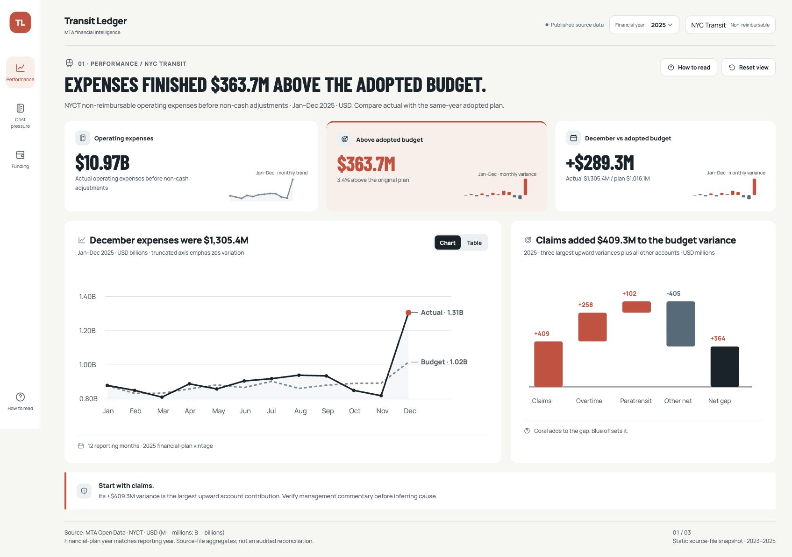
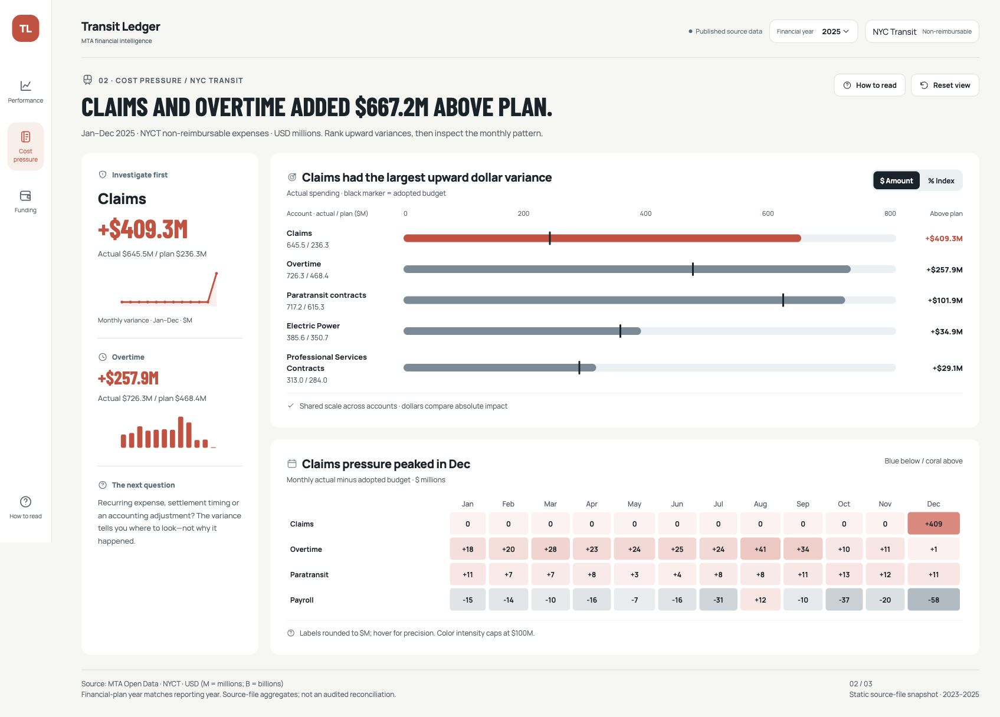
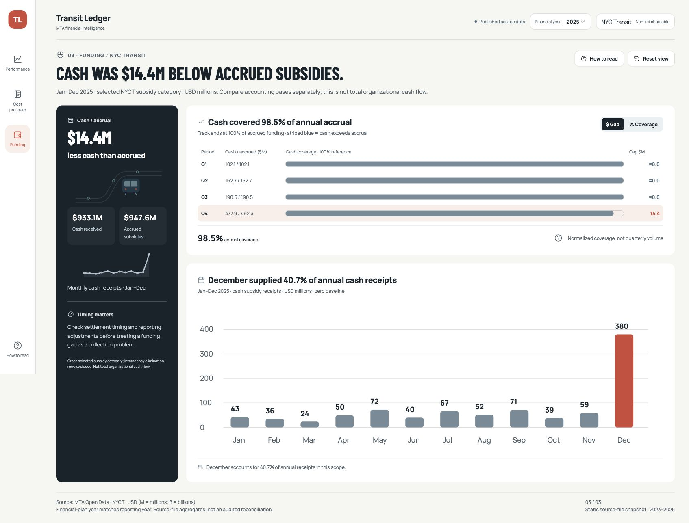

# Transit Ledger — MTA Financial Dashboard

A three-page financial analytics portfolio project exploring operating expenses, budget pressure, and subsidy funding for **NYC Transit, 2023–2025**.

**Current deliverable:** an interactive, standalone HTML dashboard built with real MTA Open Data. The Power BI report is a work in progress; this repository does not contain a `.pbix` file or an assembled semantic model. Power Query loaders, 80 authored DAX measures and coded visual templates are now available in [`powerbi/`](powerbi/README.md), pending Desktop integration and DAX engine verification.



## Client & context

This is an independent portfolio study, not commissioned work or an official MTA report. It uses public transit finance data to demonstrate the reporting questions a finance team might ask during a budget review.

## Problem

Annual totals can hide the accounts and reporting periods driving a budget variance. Finance users need to move from the overall result to account-level pressure and distinguish accrued subsidies from cash receipts.

## What I built

| Page | Question | Visuals and interactions |
| --- | --- | --- |
| Performance | Where did expenses finish against the adopted budget? | KPI mini-charts, actual/budget line chart, monthly table toggle, variance waterfall |
| Cost pressure | Which accounts contributed the largest upward variances, and when? | Budget-marker bars, dollar/index toggle, monthly variance heatmap |
| Funding | How do cash receipts compare with accrued subsidies? | Quarterly coverage tracks, gap/coverage toggle, monthly cash columns |

The shared year selector updates all three pages for 2023–2025. Tooltips, a reading guide, and a reset control support exploration. SVG icons, restrained comparison colors, direct labels, and conclusion-led headlines make the findings easier to read.

## Findings in the 2025 snapshot

- Operating expenses were **$10.97B**, **$363.7M above** adopted budget, or **3.4%**.
- Claims and overtime together contributed **$667.2M** in upward variance. Other accounts partly offset this pressure; that figure is not the net overspend.
- Selected subsidy cash receipts were **$933.1M**, compared with **$947.6M** accrued: **98.5% coverage** and a **$14.4M gap**.

These are findings within the selected reporting scope, not measured business savings or evidence of the causes of variance. Management commentary is needed to explain timing and accounting adjustments.

## Preview

### Cost pressure



### Funding



## Run locally

Download or clone this repository and open `index.html` in a modern browser. No build process or server is required.

The HTML embeds its own data, styles, JavaScript, and SVG artwork. Google Fonts is optional; system fonts are used offline. `data/dashboard-data.json` is an inspectable copy of the embedded aggregates; changing that file alone does not update the dashboard.

## Data sources and scope

Source: **Metropolitan Transportation Authority**, published on New York State Open Data.

- [MTA Statement of Operations: Beginning 2019](https://data.ny.gov/Transportation/MTA-Statement-of-Operations-Beginning-2019/yg77-3tkj)
- [MTA Subsidies: Beginning 2019](https://data.ny.gov/Transportation/MTA-Subsidies-Beginning-2019/dfg9-c5rx)
- [MTA Open Data program](https://www.mta.info/open-data)

This repository contains a static aggregate snapshot prepared on November 1, 2026. The reporting years are 2023–2025; there is no live refresh. The original filtered source CSVs are included under [`data/raw/`](data/raw/), with download filters and checksums.

**Operations filters:** agency NYCT; expense type NREIMB; fiscal year equals financial-plan year; Actual versus Adopted Budget; `Total Expenses Before Non-Cash Liability Adjs.` account grouping. Matching plan vintages avoids adding repeated forecasts from different publication years.

**Funding filters:** agency NYCT; Actual scenario; fiscal year equals financial-plan year; `Total Dedicated Taxes & State and Local Subsidies`. Cash and accrual (source code NREIMB) are aggregated separately. Interagency elimination rows are excluded from this selected gross category.

**Limits:** this is not total organizational cash flow, a consolidated MTA statement, an audited reconciliation, or a full income statement. Amounts are USD; M means millions and B means billions. Calculations use unrounded values; displayed labels are rounded. Each KPI mini-chart has its own scale. Main line-chart axes are truncated and disclosed; bars start at zero, while waterfall steps encode cumulative changes. Coverage tracks end at 100%; stripes and the percentage label identify cash above accrual. The transit SVG is original decorative artwork, not a geographic map.

## Data model direction

The broader Power BI design discussed for this project is a constellation of three fact tables sharing dimensions. This is a **target model**, not an exported semantic model included in this repository.

| Fact | Intended grain | Measure |
| --- | --- | --- |
| `fact_operations` | Month × agency × scenario × financial-plan year × reimbursement type × operating account | Amount |
| `fact_subsidies` | Month × agency × scenario × financial-plan year × accounting basis × subsidy account | Amount |
| `fact_ridership` | Date × transport mode | Count |

Date, agency, scenario, and plan-year dimensions serve the relevant finance facts. Operating account and reimbursement dimensions serve operations; subsidy account and accounting basis serve subsidies; transport mode serves ridership. Relationships should be one-to-many from unique dimension keys to facts, with single-direction filtering. Avoid direct fact-to-fact relationships. Ridership is not visualized in this HTML version.

## Stack and validation

- HTML, CSS, vanilla JavaScript, and inline SVG for the dashboard.
- Python/pandas used during source inspection and aggregation; the aggregation pipeline is not packaged in this initial release.
- Browser checks covered page navigation, year selection, chart/table, dollar/index and funding coverage controls, help, and reset. JavaScript syntax was checked. Monthly aggregate sums were checked against the annual values.

## Design approach

The narrative moves from **overall performance → account pressure → funding basis**. The supplied storytelling guide informed the editorial typography, direct labels, explicit units, muted comparison series, and factual annotations. Carousel-specific dimensions were adapted to a web dashboard.

[Gustavo Bavia’s The World of Peaches](https://github.com/gusbavia/the-world-of-peaches) was a reference for portfolio presentation and dashboard planning. This repository contains the Transit Ledger files developed for this project; it does not include that project's assets or code.

## How I would adapt this for a client

Replace the source snapshot with the client's governed finance data; agree on account mappings, plan versions, and favorable variance rules; implement the semantic model and measures; reconcile totals with finance; then add scheduled refresh and deployment. Those production steps are not implemented here.

## Repository contents

```text
index.html                    Standalone interactive dashboard
data/dashboard-data.json      Aggregate snapshot used by the HTML
data/raw/                     Original filtered CSVs, manifest and source notes
screenshots/performance.png   Performance page
screenshots/cost-pressure.png Cost pressure page
screenshots/funding.png       Funding page
```

Public availability of this portfolio does not replace the original data provider's terms. Consult the linked sources for current data and usage conditions. No affiliation with or endorsement by MTA is implied.

## Build this in Power BI

Start with the [Power BI build kit](powerbi/README.md): 80 DAX measures, Power Query source loaders, six Deneb charts, HTML/SVG cards, theme, vector backgrounds, bulk measure importer and page-by-page field mapping. The kit has source-arithmetic checks and chart compilation checks; Power BI Desktop integration remains to be completed.
